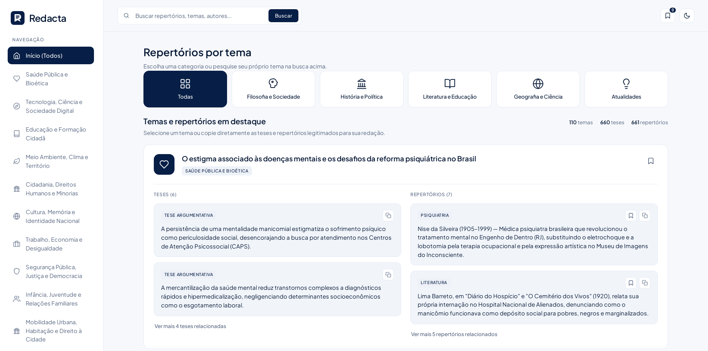
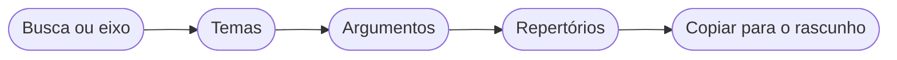
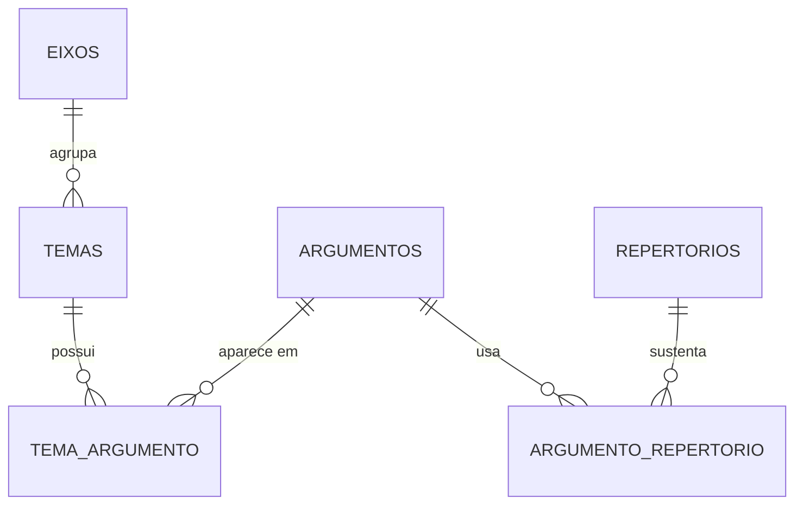

# Redacta - Eixos, Argumentos e Repertórios para Redações de ENEM e Vestibulares

> Plataforma web de pesquisa rápida para o planejamento da redação. O estudante busca um tema
> e encontra, em segundos, eixos temáticos, argumentos estruturados e repertórios
> socioculturais legítimos, para consultar lado a lado com a folha de rascunho.


<p align="center">
  
</p>

**Veja o sistema no ar:** [redacta-phi.vercel.app](https://redacta-phi.vercel.app/)

---

## Ideia, Objetivo Principal & Público-Alvo

- **Ideia & Objetivo:** Eliminar o bloqueio criativo no momento mais crítico da redação, o
  planejamento. O Redacta conecta temas, teses e referências de várias áreas do conhecimento
  em uma interface leve, direta e sem distrações.
- **Público-Alvo:**
  - **Estudantes** que se preparam para o ENEM e vestibulares;
  - **Professores de redação** que precisam de uma base rápida de eixos, argumentos e repertórios.
- **Problema:** Na hora de planejar o texto, o aluno perde tempo procurando repertório em
  vários sites e acaba recorrendo aos mesmos exemplos de sempre. Falta um lugar que ligue o
  tema ao argumento e o argumento a um repertório confiável.
- **Solução & Valor:** Busca em tempo real sobre uma base organizada em eixos, temas,
  argumentos e repertórios. O sucesso é encontrar o que precisa em poucos segundos após
  pesquisar um tema, com linguagem acadêmica, mas acessível.

### Como o conteúdo é organizado

| Camada | O que representa | Exemplo de uso |
| ------ | ---------------- | -------------- |
| **Eixo** | Grande área temática | Bioética, sociedade digital, meio ambiente, cidadania |
| **Tema** | Proposta de redação dentro de um eixo | Um tema que poderia cair na prova |
| **Argumento** | Linha de raciocínio para defender uma tese | Parágrafo de desenvolvimento |
| **Repertório** | Referência que sustenta o argumento | Filosofia, sociologia, história, literatura, cinema |


### Fluxo de pesquisa



---

## Endpoints da API

| Método | Rota | Descrição |
| ------ | ---- | --------- |
| `GET` | `/api/eixos` | Lista os eixos temáticos |
| `GET` | `/api/categorias` | Lista as categorias de repertório |
| `GET` | `/api/temas` | Lista os temas |
| `GET` | `/api/temas/:id` | Tema com argumentos e repertórios |
| `GET` | `/api/temas/busca` | Busca por termo, tema ou palavra-chave |
| `GET` | `/api/temas/recomendar` | Sugestões de temas |

---

## Modelo de Dados

PostgreSQL hospedado no **Supabase**. Os scripts ficam em [`backend/sql`](backend/sql/).

| Tabela | Principais campos |
| ------ | ----------------- |
| `eixos` | id, nome |
| `temas` | id, titulo, eixo_id |
| `argumentos` | id, descricao |
| `repertorios` | id, categoria, conteudo |
| `tema_argumento` | tema_id, argumento_id (N:N) |
| `argumento_repertorio` | argumento_id, repertorio_id (N:N) |

<details>
<summary>Ver o diagrama de relacionamento das tabelas</summary>



</details>

---

## Tecnologias

- **Frontend:** HTML5, CSS3 e JavaScript puro (Vanilla JS), sem dependências pesadas, para carregamento instantâneo
- **Backend:** Node.js com Express 5, `cors`, `dotenv` e `pg`
- **Banco de dados:** PostgreSQL (Supabase)
- **Deploy:** Vercel (`@vercel/node` para a API e `@vercel/static` para o frontend)

---

## Estrutura do Repositório

<details>
<summary>Ver a estrutura de pastas</summary>

```text
redacta/
├── backend/
│   ├── server.js            API Express (rotas e busca)
│   ├── db.js                conexão com o PostgreSQL
│   └── sql/
│       ├── create_tables.sql
│       └── seed.sql         eixos, temas, argumentos e repertórios
├── frontend/
│   ├── index.html
│   ├── app.js
│   └── styles.css
├── docs/                    escopo, fases e fluxo de trabalho
├── PRODUCT.md
├── vercel.json
└── README.md
```

</details>
